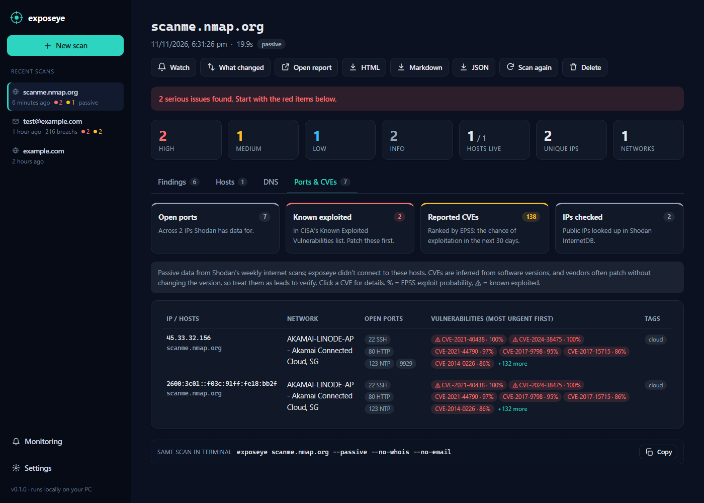
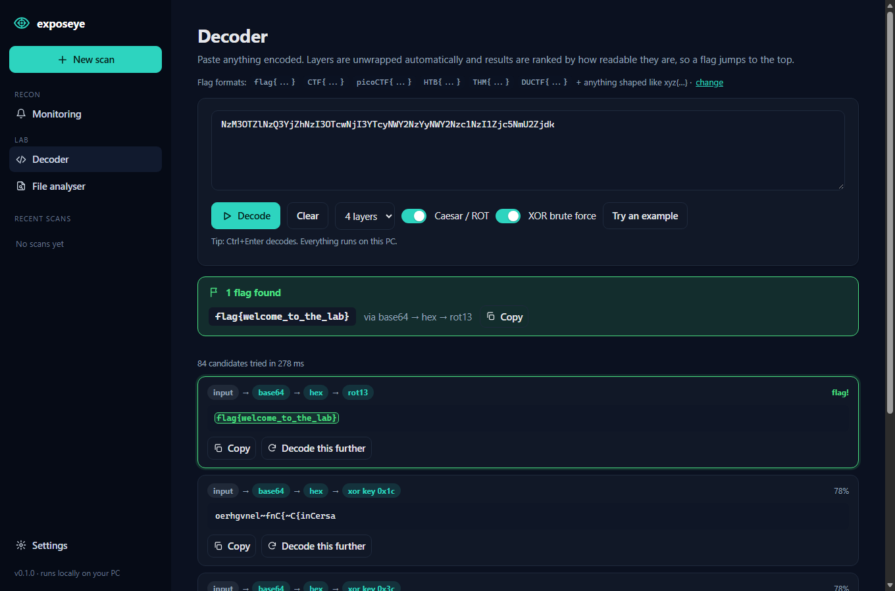
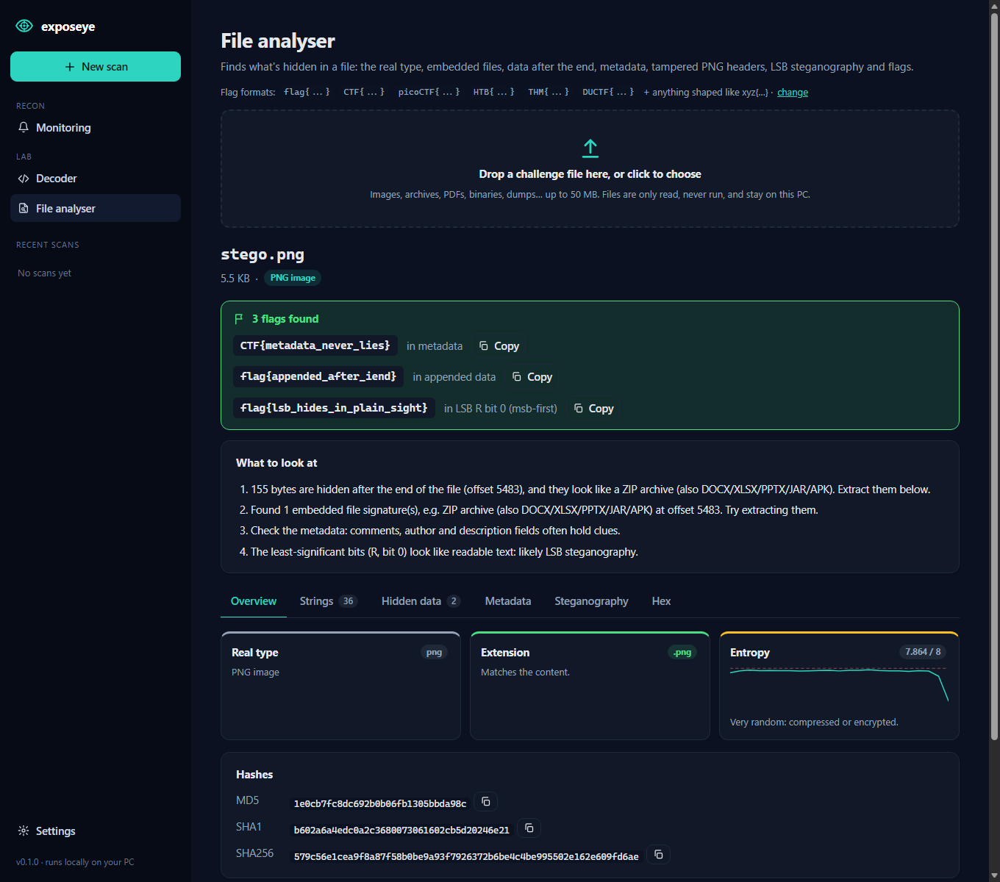
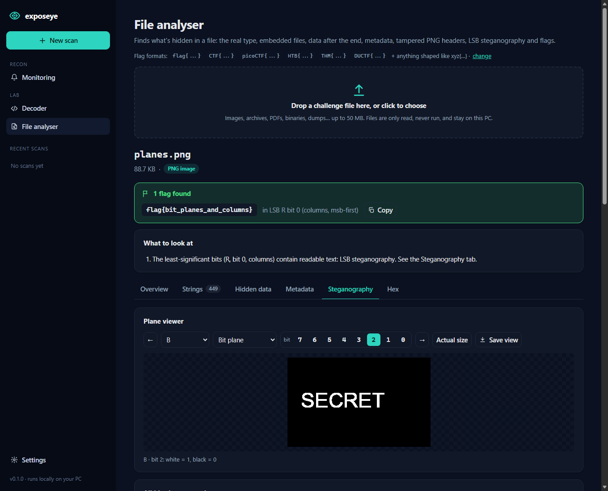
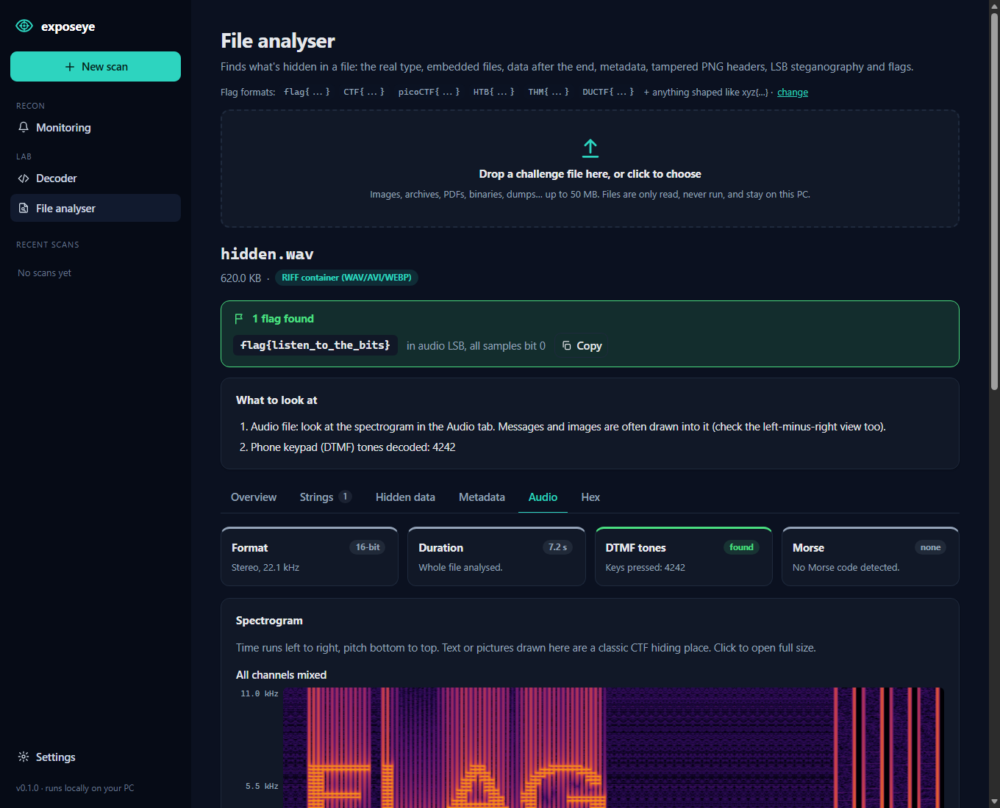
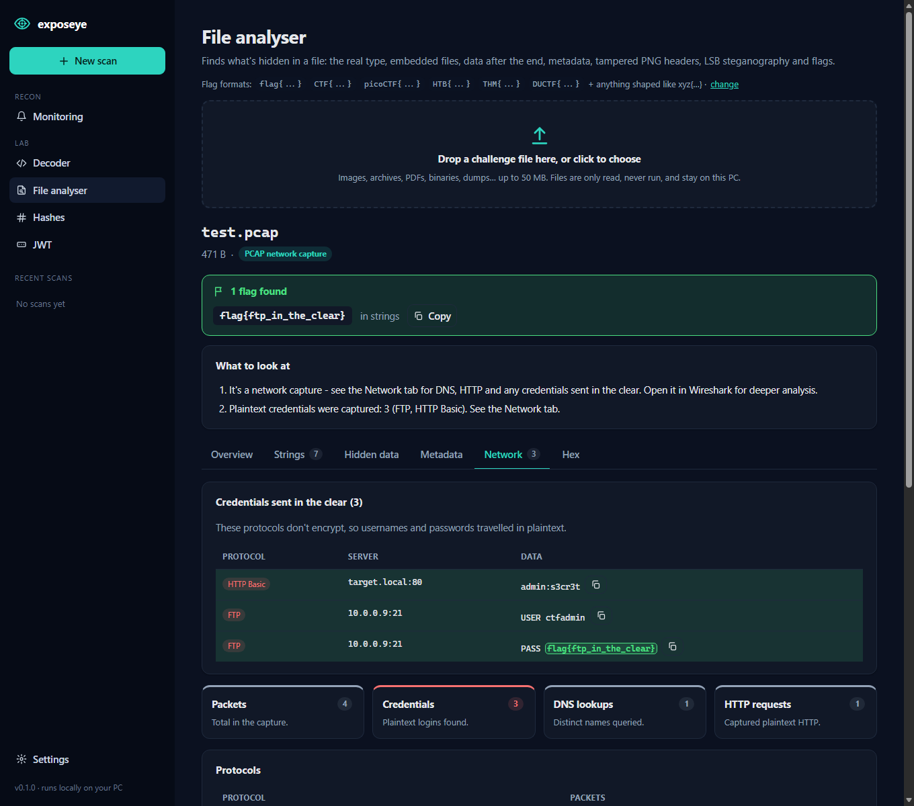
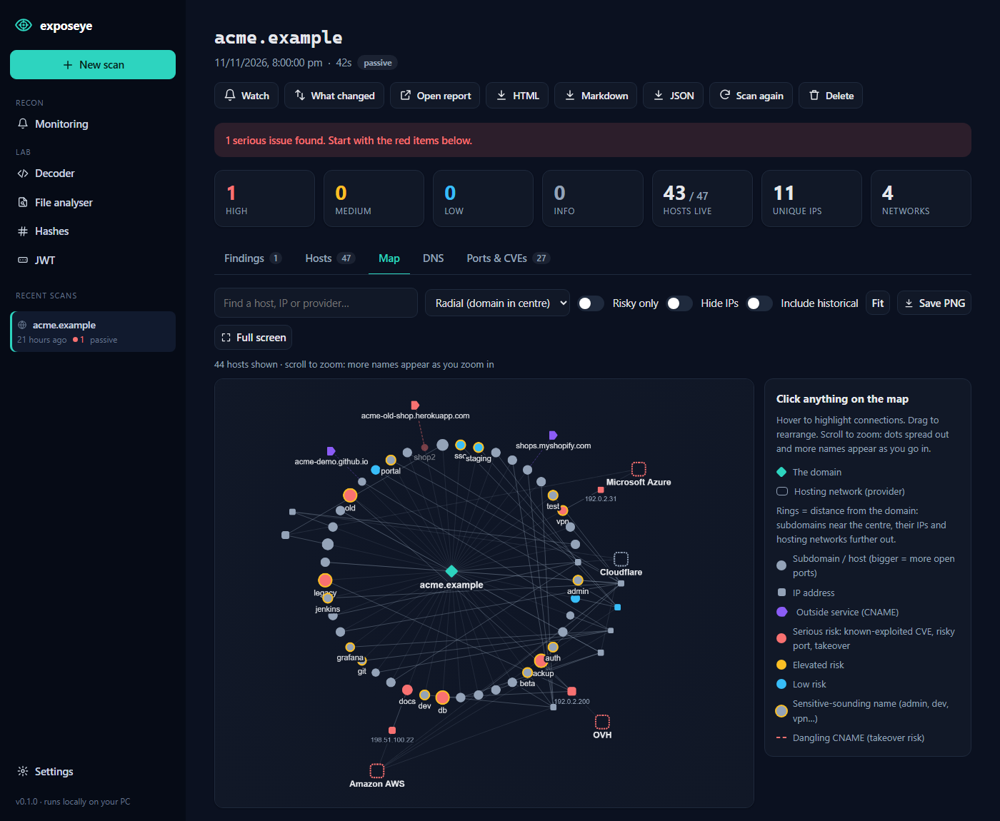

<h1> exposeye</h1>

[](https://github.com/Ashtr1cks/exposeye/actions/workflows/ci.yml)


**A local, all-in-one cybersecurity toolkit: OSINT recon, monitoring and a CTF lab, as a desktop app and a CLI.**

- **Domains:** registration, DNS and email-security posture, subdomains from Certificate
  Transparency logs, hosting, and optional HTTP/TLS checks.
- **Open ports & CVEs:** exposed services and known vulnerabilities on every IP, ranked by real
  exploitation (CISA KEV) and exploit probability (EPSS).
- **Emails:** which data breaches include an address, and whether passwords leaked. Plus a
  private password-leak check.
- **Monitoring:** re-checks on a schedule and alerts you when something changes for the worse.
- **CTF Lab:** an auto-decoder that peels off layered encodings, and a file analyser for
  forensics and steganography challenges, with flags highlighted wherever they turn up.

Every finding is explained in plain English, and any scan can be exported as HTML, Markdown or
JSON. No API keys, no accounts, and nothing to configure.

> Formerly **domainscope**. Old links redirect, and existing scan history moves to
> `~/.exposeye` automatically on first run.


## The app

Pick what you want to find out, type a domain, and press **Run scan**. No commands to remember.

| Task | What it does |
|---|---|
| **Full recon** | Everything below in one go |
| **Quiet look** | Public sources only; never contacts the domain's servers |
| **Email spoofing check** | SPF, DMARC, MTA-STS: can someone send fake mail as this domain? |
| **Find subdomains** | Certificate-log search, dangling-CNAME / takeover detection |
| **Open ports & vulnerabilities** | Exposed services (RDP, databases…) and known CVEs on every IP, passively |
| **Website security check** | Security headers, TLS certificate, version leaks |
| **Who owns it?** | Registrar, dates, name servers, abuse contact |
| **Email exposure check** | Which data breaches include an email, and whether passwords leaked |
| **Has my password leaked?** | Checks a password against 900M+ leaked passwords, privately |

Results show a one-line verdict, severity counts, and tabs for findings, hosts, DNS, email,
websites and registration. Each finding has a **What does this mean?** explanation. Scans are
saved to `~/.exposeye` so your history persists, and the app shows the equivalent CLI command
for every scan so you can script it later.

<details><summary>Screenshot: new scan form</summary>


</details>

### Email exposure check

Answers two questions: *which breaches is this email in?* and *was my password exposed?*

- **Breaches:** site, date, number of accounts, and what leaked (passwords, phone numbers, and so
  on). Password storage is graded where known: plain text, weakly hashed, or strongly hashed.
- **What to do:** a prioritised action list naming the exact sites whose passwords you should
  change.
- **Email domain:** whether the domain receives mail, whether it's free, custom or disposable, and
  its SPF/DMARC.
- **Public profile:** any Gravatar profile and linked accounts tied to the address.

Breach data comes from [XposedOrNot](https://xposedornot.com) by default (free, no key, about 25
checks an hour). Add a [Have I Been Pwned](https://haveibeenpwned.com/API/Key) key in **Settings**
or set `HIBP_API_KEY` to use HIBP instead.

**Password check privacy:** the password is hashed with SHA-1 inside the app page, and only the
first 5 hex characters are sent to the
[Pwned Passwords range API](https://haveibeenpwned.com/API/v3#PwnedPasswords). The API returns
every leaked hash with that prefix, padded with decoys, and the match happens locally
(k-anonymity). The password never reaches exposeye's own server, disk or history.

By design, exposeye never retrieves actual leaked passwords, and it doesn't probe sign-up or
reset pages to enumerate accounts. Check your own address, or someone else's with their consent.

<details><summary>Screenshot: email exposure results</summary>


</details>

**Start it:**

- **Windows:** double-click **`Start exposeye.cmd`**. The first run sets everything up.
- **Any OS:** `pip install -e ".[desktop]"` then run `exposeye-app`

It opens in its own window (via [pywebview](https://pywebview.flowrl.com/)), or in your browser
if pywebview isn't installed or you pass `--browser`. The server only listens on `127.0.0.1` and
rejects requests with any other `Host` header, which blocks DNS-rebinding attacks.

## Open ports & vulnerabilities

For every IP the scan finds, exposeye asks [Shodan InternetDB](https://internetdb.shodan.io/)
what Shodan's own internet-wide scans saw there: open ports, detected software, tags and CVE IDs.
This is passive, so exposeye never connects to the hosts, and it works in Quiet look mode. CVEs
are then ranked so the urgent ones stand out:

- **CISA KEV:** CVEs being exploited in real attacks (and whether ransomware groups use them).
  These are reported as **high**.
- **FIRST EPSS:** the probability of exploitation in the next 30 days. 50% or more is **high**,
  10% or more is **medium**, and everything else is **low**.
- **Risky services** exposed to the internet, such as RDP, SMB, Telnet, VNC, databases
  (MySQL/Postgres/MongoDB/Redis/Elasticsearch), the Docker API, and end-of-life software.

Monitoring alerts when a risky port opens or a new known-exploited CVE appears.

> CVEs are inferred from version banners, and vendors often backport fixes without changing the
> version string, so treat them as leads to verify. InternetDB is free for non-commercial use and
> is refreshed weekly.



## CTF Lab

Tools for Capture-the-Flag challenges, under **Lab** in the sidebar. Set your competition's flag
format once in Settings (for example `picoCTF{...}`, or `re:` plus a regex). Every Lab tool then
hunts for it and highlights matches, including deep inside decoded layers, metadata or hidden
files.

**Decoder:** paste anything encoded. It tries base64, base32, base58, base85, hex, binary,
decimal and octal bytes, URL encoding, HTML entities, `\x`/`\u` escapes, Morse, ROT13 and all
Caesar shifts, ROT47, Atbash, reversal, single-byte XOR brute force, and gzip, zlib, bzip2 and xz.
It follows multi-layer chains (for example base64 → hex → ROT13) and ranks outputs by how much
they look like English or a flag. Any result can be decoded further with one click.

**File analyser:** drop in a challenge file (it's only read, never run). It reports:
- The **real file type** from magic bytes, flagging extensions that lie
- **Embedded files** (binwalk-style signature scan) and **data appended after the end** of PNG,
  JPEG, PDF and ZIP files, all extractable with one click
- **ZIP archives inside images**: lists them and searches even *compressed* member files for flags
- **Metadata:** EXIF with GPS shown on a map, PNG text chunks, PDF info (JavaScript, embedded
  files, revisions) and Office document properties
- **Tampered PNG headers:** a height or width edited to hide part of the image is detected from
  the checksum, and the real size is recovered with a download of the repaired image
- **Image steganography**, a built-in alternative to Stegsolve and zsteg:
  - A plane viewer for every bit (0–7) of R, G, B, alpha, luminance and palette indices, plus
    full-channel, inverted and random-colour filters. Step through with ← / → and click any
    plane in the overview grid.
  - Automatic LSB extraction across 90+ combinations (rows, columns or reversed; bits 0–2;
    MSB- or LSB-first packing; palette indices), ranked by readable text, file headers and flags
- **Audio steganography (WAV):** spectrograms, including a left-minus-right view that exposes
  signals hidden in one stereo channel, plus sample LSB extraction and DTMF and Morse decoding
- **Text steganography:** zero-width Unicode characters and trailing-whitespace encodings (also
  in the Decoder)
- **JPEG and compressed audio:** explains why LSB doesn't apply and which tool to use (stegseek,
  steghide, ffmpeg), and detects whether you have it installed
- Strings (ASCII and UTF-16), an entropy graph, hashes and a hex view, plus plain-English
  **"what to look at"** hints

**Hash cracker:** identifies a hash from its shape (MD5, SHA-x, NTLM, bcrypt, Linux shadow,
and so on) and recovers weak passwords from the built-in common list, words you paste, or a
wordlist file such as `rockyou.txt`. Salted or slow schemes are identified and handed off to
john/hashcat. This is the standard "crack this CTF hash" workflow, run locally.

**JWT inspector:** decodes a JSON Web Token's header and payload, flags the classic weaknesses
(`alg: none`, weak HMAC secret, RS/HS algorithm confusion, `jku`/`kid` tricks, expiry), finds a
weak signing secret from a wordlist, and forges tokens (`alg:none` or re-signed with a recovered
secret) to paste back into a challenge or your own test app.

**Network capture (PCAP/PCAPNG):** drop a capture into the File analyser for a **Network** tab:
protocol and talker breakdown, DNS queries, HTTP requests, and — the usual goal — any credentials
sent in the clear (HTTP Basic, FTP, POP3). Parsing is built in, so no extra dependency.

```bash
exposeye-lab decode "NzM3OTZlNzQ3YjZh..."     # auto-decode from the terminal
exposeye-lab --flag "myctf{...}" file chall.png
exposeye-lab hash 5f4dcc3b5aa765d61d8327deb882cf99 --wordlist rockyou.txt
exposeye-lab jwt eyJhbGci...                   # decode + check a token
```



<details><summary>Screenshots: file analyser and steganography</summary>








</details>

Reverse engineering and binary exploitation are better served by dedicated tools (Ghidra,
pwntools). The analyser triages executables (format and architecture, plus strings) and says so.
Planned next for the Lab: RSA and classical-cipher helpers.

## Association map

Every domain scan gets a **Map** tab: an interactive graph linking the domain to its
subdomains, their IP addresses, the hosting networks behind them, and outside services they point
to via CNAME. It surfaces patterns a table hides:

- **Shared infrastructure:** many subdomains on one server means one compromise or CVE affects
  them all.
- **Outside dependencies:** CNAMEs to Heroku, Shopify, GitHub Pages and so on, with dangling ones
  (subdomain-takeover risk) drawn as red dashed links.
- **Where risk concentrates:** nodes are coloured by their worst issue (known-exploited CVE, risky
  open port, takeover). Bigger nodes have more open ports, and amber rings mark sensitive-sounding
  names.

**Grouped by provider (default):** each hosting provider (Amazon AWS, Cloudflare, Microsoft
Azure…) gets its own region, laid out separately and packed with gaps between them. A region's
border shows the worst risk inside it. Outside services and names that no longer resolve get
their own regions too, and the domain links once to each region instead of to every host.
**Free-form** switches to a force-directed view.

**Semantic zoom:** as you zoom in, dots grow more slowly than the space between them, so the map
spreads out instead of just getting bigger. Text stays a constant, readable size, and labels
appear in tiers: providers and risky hosts first, then all hosts, then IP addresses. Whatever you
hover, select or search for is always labelled.

**Full screen** expands the map to the whole screen (Esc to exit). Click any node or region for
details (ports, ranked CVEs, website, hosts sharing an IP or provider). Hover to highlight a
host's chain through IP to provider, and search to find a node. **Risky only**, **Hide IPs** and
**Include historical** keep big scans readable, and **Save PNG** exports the map for a report. The
graph uses [Cytoscape.js](https://js.cytoscape.org/) (MIT), bundled locally so the app works
offline and never loads code from the internet.



*Screenshot uses a fictional demo company (`acme.example`) with documentation-only IP addresses.*

## Monitoring

A single scan is a snapshot; monitoring tells you **what changed**. Add domains you own (and
your own email addresses) to the watchlist, and exposeye re-checks them daily or weekly. Each
new scan is compared with the previous one, changes are recorded in a timeline, and you're
alerted when something gets worse.

Detected changes include:
- New or vanished live hosts, with "interesting" names like `admin` or `vpn` flagged
- New dangling CNAMEs (subdomain takeover risk)
- NS/MX changes, DNSSEC turned off, and a weaker SPF/DMARC policy
- Registrar change, domain on hold, or registration expiring within 30 days
- TLS certificates becoming invalid or crossing 30 and 7 days to expiry
- Security headers removed and new version leaks
- For emails: new breaches, highlighting any with exposed passwords

Improvements (DMARC strengthened, certificate renewed, header added) are recorded too, but don't
trigger alerts. The engine only compares what both scans actually measured: if crt.sh is down
or a check was switched off, that area is skipped rather than reported as "47 subdomains
disappeared".

**Alerts:** Windows desktop notifications, and optionally a Discord webhook, so alerts reach your
phone too.

**When checks run:**
- **While the app is open:** due items are checked automatically every minute.
- **In the background (Windows):** one click on the Monitoring page registers an hourly Task
  Scheduler job. It runs `exposeye-watch run --quiet` with `pythonw` (no window) and only
  scans items that are due, so it catches up after the PC was off. On macOS/Linux, put the same
  command in cron.

Any result page also has **What changed** (compare with the previous scan of the same target)
and **Watch** (start monitoring, using that scan as the baseline).

```bash
exposeye-watch add example.com --weekly --full
exposeye-watch add me@example.com
exposeye-watch run            # scan whatever is due
exposeye-watch changes        # recent change timeline
exposeye-watch install-task   # hourly background checks (Windows)
```

## The CLI

```text
$ exposeye example.com --open
[+] WHOIS ........ RESERVED-Internet Assigned Numbers Authority, created 1995-08-14
[+] DNS .......... A:6, AAAA:6, MX:1, NS:2, TXT:2, SOA:1
[!] Email sec .... SPF -all, DMARC p=reject
[+] CT logs ...... 14 unique names (crt.sh 14, certspotter 3)
[+] Resolve ...... 6/14 hosts resolve
[+] ASN .......... 12 IPs across 1 networks
[+] HTTP ......... 6/6 probed hosts responded
[+] TLS .......... 6 certificates, 0 problems
[✓] report saved -> reports/example.com_20260101-120000.html
```

## What it checks

| Module | Source | What you get | Touches target? |
|---|---|---|---|
| **Registration** | [RDAP](https://about.rdap.org/) (WHOIS successor) | Registrar, dates, status, name servers, abuse contact, domain age | No |
| **DNS** | Your resolver | A/AAAA/CNAME/MX/NS/TXT/SOA/CAA, DNSSEC, wildcard detection | Via DNS only |
| **Email security** | DNS | SPF (qualifier, lookup count), DMARC policy, MTA-STS, TLS-RPT | Via DNS only |
| **Subdomains** | [crt.sh](https://crt.sh), [Cert Spotter](https://sslmate.com/certspotter/) | Every hostname that ever appeared on a public TLS certificate | No |
| **Resolution** | DNS | Live vs historical hosts, CNAME chains, **dangling CNAMEs** (subdomain-takeover candidates) | Via DNS only |
| **Hosting / ASN** | [Team Cymru](https://www.team-cymru.com/ip-asn-mapping) over DNS | IP → ASN, prefix, network owner | No |
| **Open ports & CVEs** | [Shodan InternetDB](https://internetdb.shodan.io/), [CISA KEV](https://www.cisa.gov/known-exploited-vulnerabilities-catalog), [FIRST EPSS](https://www.first.org/epss/) | Open ports per IP, CVEs ranked by known exploitation and exploit probability, end-of-life software | No |
| **HTTP** | Direct | Status, title, redirects, missing security headers, version leaks, tech fingerprint | **Yes** |
| **TLS** | Direct | Certificate validity, issuer, expiry, SANs, protocol | **Yes** |

Findings are graded **high / medium / low / info**. Examples: `+all` SPF, a missing DMARC
record, dangling CNAMEs to takeover-prone providers, expiring certificates, missing HSTS/CSP, and
`Server: Apache/2.4.41` version disclosure.

## Install

Requires Python 3.10+.

```bash
git clone https://github.com/Ashtr1cks/exposeye.git
cd exposeye
python -m venv .venv
# Windows:  .venv\Scripts\activate
# Linux/macOS: source .venv/bin/activate
pip install -e ".[desktop]"   # drop [desktop] if you only want the CLI + browser UI
```

Or install it as a global CLI with [pipx](https://pipx.pypa.io/): `pipx install .`

## Usage

```bash
exposeye example.com                    # full scan, all report formats into ./reports
exposeye example.com --passive --open   # no direct contact with target; open HTML when done
exposeye https://shop.example.com/x     # URLs are fine, it extracts the host
exposeye a.com b.org -f json -o out/    # several domains, JSON only
exposeye example.com --resolver 1.1.1.1 --probe-limit 50
python -m exposeye --help               # works without the console script too
```

| Option | Default | Description |
|---|---|---|
| `--passive` | off | Skip HTTP/TLS probing; only public data sources and DNS are used |
| `--no-subdomains` | off | Skip Certificate Transparency discovery |
| `--no-whois` | off | Skip the registration (RDAP) lookup |
| `--no-email` | off | Skip SPF/DMARC/MTA-STS checks |
| `--no-exposure` | off | Skip the open-port/CVE lookup |
| `-f, --format` | `html,md,json` | Report formats to write |
| `-o, --output-dir` | `reports` | Where reports go |
| `--open` | off | Open the HTML report in your browser |
| `--no-report` | off | Print findings only |
| `--probe-limit` | 25 | Max hosts to HTTP/TLS probe |
| `--max-hosts` | 1000 | Max discovered names to resolve |
| `--workers` | 20 | DNS concurrency |
| `--timeout` | 10 | Network timeout (seconds) |
| `--resolver IP` | system | DNS resolver (repeatable) |

The JSON report has a stable structure (`meta`, `rdap`, `dns`, `email`, `hosts`, `asn`, `http`,
`tls`, `findings`, `summary`, `errors`), so you can pipe it into `jq` or other tools.

### Email checks from the terminal

```bash
exposeye-email you@example.com --open     # breach report (HTML/MD/JSON)
exposeye-email --password                  # hidden prompt, k-anonymity check
exposeye-email you@example.com --hibp-key KEY
```

## Project layout

```text
src/exposeye/
├── app.py              # desktop launcher (pywebview window or browser)
├── web/
│   ├── server.py       # FastAPI API: background scans, SSE progress, history
│   └── static/         # single-page UI (vanilla JS, no build step)
├── cli.py              # domain CLI (argparse + rich)
├── email_cli.py        # email/password CLI
├── scanner.py          # domain scan: runs modules, aggregates findings
├── emailcheck.py       # email check: breaches, domain, profile, advice
├── watch_cli.py        # monitoring CLI (used by the scheduled task)
├── lab_cli.py          # CTF lab CLI (decode / file)
├── lab/
│   ├── flags.py        # flag-format hunter shared by all Lab tools
│   ├── decoder.py      # auto-decoder (beam search over encodings)
│   └── files.py        # file analyser: signatures, metadata, PNG repair, LSB stego
├── settings.py         # ~/.exposeye/settings.json (HIBP key, alert settings)
├── storage.py          # scan history + cross-process file lock
├── monitor/
│   ├── diff.py         # "what changed" engine (domain + email)
│   ├── watchlist.py    # watchlist + change timeline
│   ├── runner.py       # run due items, diff, record, alert
│   ├── notify.py       # Windows toast + Discord webhook
│   └── task.py         # Windows Task Scheduler integration
├── report.py           # JSON / Markdown / HTML rendering
├── templates/          # Jinja2 report templates (HTML is self-contained)
└── modules/
    ├── rdap.py         # registration data
    ├── dns_records.py  # records, wildcard, resolution, dangling CNAMEs
    ├── email_security.py
    ├── subdomains.py   # crt.sh + Cert Spotter
    ├── asn.py          # Team Cymru DNS lookups
    ├── http_probe.py   # headers, fingerprinting
    ├── tls_info.py     # certificate inspection (stdlib ssl)
    ├── exposure.py     # Shodan InternetDB ports/CVEs + KEV + EPSS
    ├── breaches.py     # XposedOrNot / HIBP breach lookups
    ├── passwords.py    # Pwned Passwords k-anonymity check
    └── email_identity.py  # provider type, disposable list, Gravatar
tests/                  # offline unit + API tests (no network needed)
```

## Development

```bash
pip install -e ".[dev]"
pytest
ruff check .
```

To add a module, write a function that returns plain dicts, add a `findings()` helper that yields
`(severity, title, detail)` tuples, and call both from `scanner.py`.

## Roadmap

- [ ] Optional API-key sources (SecurityTrails, Shodan, VirusTotal) via env vars
- [ ] Historical snapshots from the Wayback Machine (`/robots.txt`, old endpoints)
- [ ] Zone transfer (AXFR) check against each authoritative NS
- [x] Monitoring: scheduled re-scans, change detection, alerts
- [ ] GitHub Actions template for monitoring (private repos only)
- [ ] Export findings to CSV / STIX

## Legal and ethical use

This tool is for **education, defensive security, and authorised assessments**. Passive mode
uses only public data. Active mode sends ordinary HTTP(S) requests, which is roughly what a
browser does, but you should still only scan domains you own or have written permission to
test. You are responsible for how you use it.

## License

[MIT](LICENSE)
