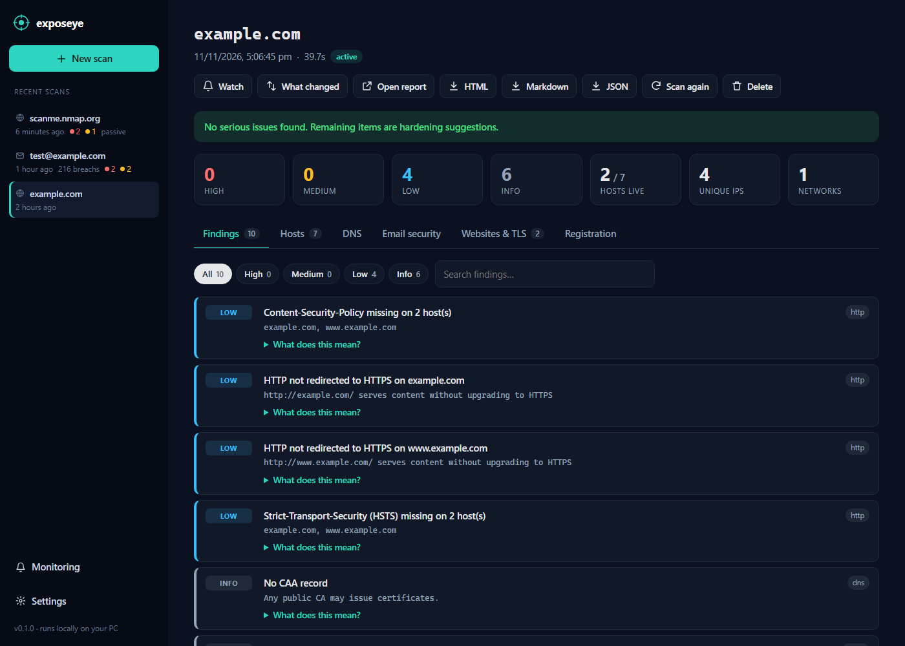
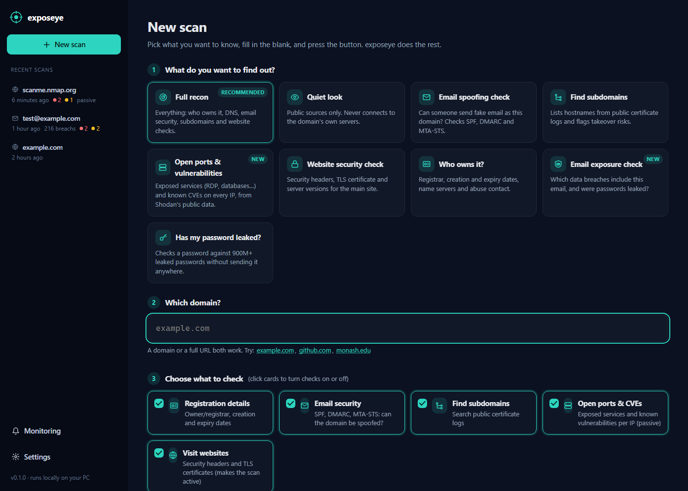
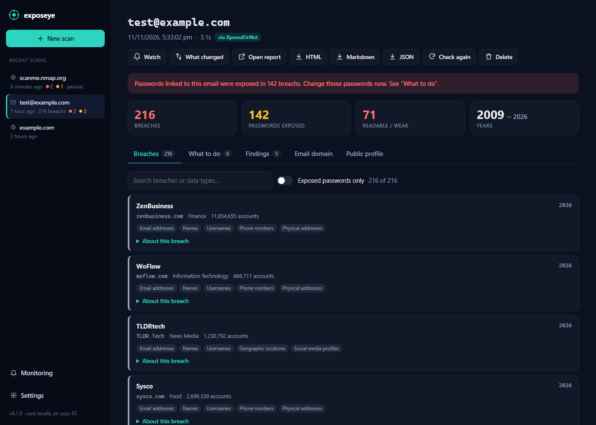

# domainscope

[](https://github.com/Ashtr1cks/domainscope/actions/workflows/ci.yml)


**Passive-first domain reconnaissance (OSINT): a desktop app and a CLI.** Point it at a domain
and get registration data, DNS and email-security posture, subdomains from Certificate
Transparency logs, hosting/ASN mapping, and (optionally) HTTP/TLS checks, with every finding
explained in plain English. Export any scan as HTML, Markdown or JSON.

No API keys, no accounts, and nothing to configure.



## The app

Pick what you want to find out, type a domain, and press **Run scan**. No commands to remember.

| Task | What it does |
|---|---|
| **Full recon** | Everything below in one go |
| **Quiet look** | Public sources only; never contacts the domain's servers |
| **Email spoofing check** | SPF, DMARC, MTA-STS: can someone send fake mail as this domain? |
| **Find subdomains** | Certificate-log search, dangling-CNAME / takeover detection |
| **Website security check** | Security headers, TLS certificate, version leaks |
| **Who owns it?** | Registrar, dates, name servers, abuse contact |
| **Email exposure check** | Which data breaches include an email, and whether passwords leaked |
| **Has my password leaked?** | Checks a password against 900M+ leaked passwords, privately |

Results show a one-line verdict, severity counts, and tabs for findings, hosts, DNS, email,
websites and registration. Each finding has a **What does this mean?** explanation. Scans are
saved to `~/.domainscope` so your history persists, and the app shows the equivalent CLI command
for every scan so you can script it later.

<details><summary>Screenshot: new scan form</summary>


</details>

### Email exposure check

Answers two questions: *which breaches is this email in?* and *was my password exposed?*

- **Breaches:** site, date, number of accounts, and what leaked (passwords, phone numbers, and so
  on). Password storage is graded where known: plain text, weakly hashed, or strongly hashed.
- **What to do:** a prioritised action list naming the exact sites whose passwords you should
  change.
- **Email domain:** whether the domain receives mail, whether it's free, custom or disposable, and
  its SPF/DMARC.
- **Public profile:** any Gravatar profile and linked accounts tied to the address.

Breach data comes from [XposedOrNot](https://xposedornot.com) by default (free, no key, about 25
checks an hour). Add a [Have I Been Pwned](https://haveibeenpwned.com/API/Key) key in **Settings**
or set `HIBP_API_KEY` to use HIBP instead.

**Password check privacy:** the password is hashed with SHA-1 inside the app page, and only the
first 5 hex characters are sent to the
[Pwned Passwords range API](https://haveibeenpwned.com/API/v3#PwnedPasswords). The API returns
every leaked hash with that prefix, padded with decoys, and the match happens locally
(k-anonymity). The password never reaches domainscope's own server, disk or history.

By design, domainscope never retrieves actual leaked passwords, and it doesn't probe sign-up or
reset pages to enumerate accounts. Check your own address, or someone else's with their consent.

<details><summary>Screenshot: email exposure results</summary>


</details>

**Start it:**

- **Windows:** double-click **`Start domainscope.cmd`**. The first run sets everything up.
- **Any OS:** `pip install -e ".[desktop]"` then run `domainscope-app`

It opens in its own window (via [pywebview](https://pywebview.flowrl.com/)), or in your browser
if pywebview isn't installed or you pass `--browser`. The server only listens on `127.0.0.1` and
rejects requests with any other `Host` header, which blocks DNS-rebinding attacks.

## Monitoring

A single scan is a snapshot; monitoring tells you **what changed**. Add domains you own (and
your own email addresses) to the watchlist, and domainscope re-checks them daily or weekly. Each
new scan is compared with the previous one, changes are recorded in a timeline, and you're
alerted when something gets worse.

Detected changes include:
- New or vanished live hosts, with "interesting" names like `admin` or `vpn` flagged
- New dangling CNAMEs (subdomain takeover risk)
- NS/MX changes, DNSSEC turned off, and a weaker SPF/DMARC policy
- Registrar change, domain on hold, or registration expiring within 30 days
- TLS certificates becoming invalid or crossing 30 and 7 days to expiry
- Security headers removed and new version leaks
- For emails: new breaches, highlighting any with exposed passwords

Improvements (DMARC strengthened, certificate renewed, header added) are recorded too, but don't
trigger alerts. The engine only compares what both scans actually measured: if crt.sh is down
or a check was switched off, that area is skipped rather than reported as "47 subdomains
disappeared".

**Alerts:** Windows desktop notifications, and optionally a Discord webhook, so alerts reach your
phone too.

**When checks run:**
- **While the app is open:** due items are checked automatically every minute.
- **In the background (Windows):** one click on the Monitoring page registers an hourly Task
  Scheduler job. It runs `domainscope-watch run --quiet` with `pythonw` (no window) and only
  scans items that are due, so it catches up after the PC was off. On macOS/Linux, put the same
  command in cron.

Any result page also has **What changed** (compare with the previous scan of the same target)
and **Watch** (start monitoring, using that scan as the baseline).

```bash
domainscope-watch add example.com --weekly --full
domainscope-watch add me@example.com
domainscope-watch run            # scan whatever is due
domainscope-watch changes        # recent change timeline
domainscope-watch install-task   # hourly background checks (Windows)
```

## The CLI

```text
$ domainscope example.com --open
[+] WHOIS ........ RESERVED-Internet Assigned Numbers Authority, created 1995-08-14
[+] DNS .......... A:6, AAAA:6, MX:1, NS:2, TXT:2, SOA:1
[!] Email sec .... SPF -all, DMARC p=reject
[+] CT logs ...... 14 unique names (crt.sh 14, certspotter 3)
[+] Resolve ...... 6/14 hosts resolve
[+] ASN .......... 12 IPs across 1 networks
[+] HTTP ......... 6/6 probed hosts responded
[+] TLS .......... 6 certificates, 0 problems
[✓] report saved -> reports/example.com_20260101-120000.html
```

## What it checks

| Module | Source | What you get | Touches target? |
|---|---|---|---|
| **Registration** | [RDAP](https://about.rdap.org/) (WHOIS successor) | Registrar, dates, status, name servers, abuse contact, domain age | No |
| **DNS** | Your resolver | A/AAAA/CNAME/MX/NS/TXT/SOA/CAA, DNSSEC, wildcard detection | Via DNS only |
| **Email security** | DNS | SPF (qualifier, lookup count), DMARC policy, MTA-STS, TLS-RPT | Via DNS only |
| **Subdomains** | [crt.sh](https://crt.sh), [Cert Spotter](https://sslmate.com/certspotter/) | Every hostname that ever appeared on a public TLS certificate | No |
| **Resolution** | DNS | Live vs historical hosts, CNAME chains, **dangling CNAMEs** (subdomain-takeover candidates) | Via DNS only |
| **Hosting / ASN** | [Team Cymru](https://www.team-cymru.com/ip-asn-mapping) over DNS | IP → ASN, prefix, network owner | No |
| **HTTP** | Direct | Status, title, redirects, missing security headers, version leaks, tech fingerprint | **Yes** |
| **TLS** | Direct | Certificate validity, issuer, expiry, SANs, protocol | **Yes** |

Findings are graded **high / medium / low / info**. Examples: `+all` SPF, a missing DMARC
record, dangling CNAMEs to takeover-prone providers, expiring certificates, missing HSTS/CSP, and
`Server: Apache/2.4.41` version disclosure.

## Install

Requires Python 3.10+.

```bash
git clone https://github.com/Ashtr1cks/domainscope.git
cd domainscope
python -m venv .venv
# Windows:  .venv\Scripts\activate
# Linux/macOS: source .venv/bin/activate
pip install -e ".[desktop]"   # drop [desktop] if you only want the CLI + browser UI
```

Or install it as a global CLI with [pipx](https://pipx.pypa.io/): `pipx install .`

## Usage

```bash
domainscope example.com                    # full scan, all report formats into ./reports
domainscope example.com --passive --open   # no direct contact with target; open HTML when done
domainscope https://shop.example.com/x     # URLs are fine, it extracts the host
domainscope a.com b.org -f json -o out/    # several domains, JSON only
domainscope example.com --resolver 1.1.1.1 --probe-limit 50
python -m domainscope --help               # works without the console script too
```

| Option | Default | Description |
|---|---|---|
| `--passive` | off | Skip HTTP/TLS probing; only public data sources and DNS are used |
| `--no-subdomains` | off | Skip Certificate Transparency discovery |
| `--no-whois` | off | Skip the registration (RDAP) lookup |
| `--no-email` | off | Skip SPF/DMARC/MTA-STS checks |
| `-f, --format` | `html,md,json` | Report formats to write |
| `-o, --output-dir` | `reports` | Where reports go |
| `--open` | off | Open the HTML report in your browser |
| `--no-report` | off | Print findings only |
| `--probe-limit` | 25 | Max hosts to HTTP/TLS probe |
| `--max-hosts` | 1000 | Max discovered names to resolve |
| `--workers` | 20 | DNS concurrency |
| `--timeout` | 10 | Network timeout (seconds) |
| `--resolver IP` | system | DNS resolver (repeatable) |

The JSON report has a stable structure (`meta`, `rdap`, `dns`, `email`, `hosts`, `asn`, `http`,
`tls`, `findings`, `summary`, `errors`), so you can pipe it into `jq` or other tools.

### Email checks from the terminal

```bash
domainscope-email you@example.com --open     # breach report (HTML/MD/JSON)
domainscope-email --password                  # hidden prompt, k-anonymity check
domainscope-email you@example.com --hibp-key KEY
```

## Project layout

```text
src/domainscope/
├── app.py              # desktop launcher (pywebview window or browser)
├── web/
│   ├── server.py       # FastAPI API: background scans, SSE progress, history
│   └── static/         # single-page UI (vanilla JS, no build step)
├── cli.py              # domain CLI (argparse + rich)
├── email_cli.py        # email/password CLI
├── scanner.py          # domain scan: runs modules, aggregates findings
├── emailcheck.py       # email check: breaches, domain, profile, advice
├── watch_cli.py        # monitoring CLI (used by the scheduled task)
├── settings.py         # ~/.domainscope/settings.json (HIBP key, alert settings)
├── storage.py          # scan history + cross-process file lock
├── monitor/
│   ├── diff.py         # "what changed" engine (domain + email)
│   ├── watchlist.py    # watchlist + change timeline
│   ├── runner.py       # run due items, diff, record, alert
│   ├── notify.py       # Windows toast + Discord webhook
│   └── task.py         # Windows Task Scheduler integration
├── report.py           # JSON / Markdown / HTML rendering
├── templates/          # Jinja2 report templates (HTML is self-contained)
└── modules/
    ├── rdap.py         # registration data
    ├── dns_records.py  # records, wildcard, resolution, dangling CNAMEs
    ├── email_security.py
    ├── subdomains.py   # crt.sh + Cert Spotter
    ├── asn.py          # Team Cymru DNS lookups
    ├── http_probe.py   # headers, fingerprinting
    ├── tls_info.py     # certificate inspection (stdlib ssl)
    ├── breaches.py     # XposedOrNot / HIBP breach lookups
    ├── passwords.py    # Pwned Passwords k-anonymity check
    └── email_identity.py  # provider type, disposable list, Gravatar
tests/                  # offline unit + API tests (no network needed)
```

## Development

```bash
pip install -e ".[dev]"
pytest
ruff check .
```

To add a module, write a function that returns plain dicts, add a `findings()` helper that yields
`(severity, title, detail)` tuples, and call both from `scanner.py`.

## Roadmap

- [ ] Optional API-key sources (SecurityTrails, Shodan, VirusTotal) via env vars
- [ ] Historical snapshots from the Wayback Machine (`/robots.txt`, old endpoints)
- [ ] Zone transfer (AXFR) check against each authoritative NS
- [x] Monitoring: scheduled re-scans, change detection, alerts
- [ ] GitHub Actions template for monitoring (private repos only)
- [ ] Export findings to CSV / STIX

## Legal and ethical use

This tool is for **education, defensive security, and authorised assessments**. Passive mode
uses only public data. Active mode sends ordinary HTTP(S) requests, which is roughly what a
browser does, but you should still only scan domains you own or have written permission to
test. You are responsible for how you use it.

## License

[MIT](LICENSE)
